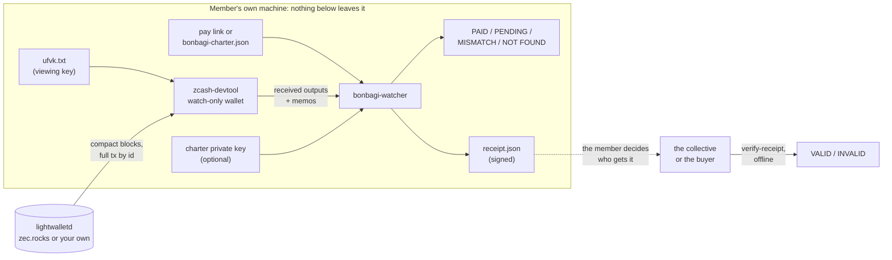

# BonBagi watcher

**Check that your share of a BonBagi payment arrived, on your own machine, with your own viewing key. No server learns who was paid how much, because there is no server.**

[BonBagi](https://bonbagi.vercel.app) lets a group that sells together get paid with one shielded Zcash payment that splits to every member, as the charter they all signed says. Nobody holds the money, and nobody outside sees who earned what. That leaves one question each member has to answer for themselves: *did my share actually arrive, and is it the right amount?*

A central service could answer it for everyone, but then that service would know every member's income. That is exactly what BonBagi exists to avoid. So the "backend" of BonBagi is this program, and **each member runs it themselves**. It reads the signed charter, scans the chain with the member's **unified full viewing key** (it can see, it can never spend), finds the member's own output by its memo, checks it against the charter, and writes a receipt signed with the member's charter key that they can show the group.

```text
=> PAID  Your share of order ord-k7m2qx9p arrived: 0.0018 TAZ in block 4540210 (211 confirmations).
   txid 95ad566a4093ec8b90bdb835edc903fd70b405d82c9a54c8103e875b87a3d6de
Receipt  receipt.json · signed with key 8a88e3dd…6f5c
```

## Run it in 60 seconds

Offline, on the bundled testnet example (no wallet, no network, no keys of yours):

```bash
docker run --rm ghcr.io/bonbagi/watcher:0.1.0 check \
  --charter examples/testnet/charter.json --snapshot examples/testnet/snapshot.json --member 1
```

Without Docker (Rust 1.99):

```bash
git clone https://github.com/BonBagi/watcher && cd watcher
cargo run --release -- check --charter examples/testnet/charter.json --snapshot examples/testnet/snapshot.json --member 1
```

You get one row per BonBagi payment to member 1 ("Dex", 60%) of the example charter. Each row is checked:

```text
  order          status            amount     height  conf  txid
  ord-k7m2qx9p   PAID          0.0018 TAZ    4540210   211  95ad566a4093ec8b…
                 · fits your 60% share of a 0.003 TAZ total
  ord-9xq2ttmh   PAID          0.0006 TAZ    4540388    33  a14b08c08861482e…
                 · fits your 60% share of a 0.001 TAZ total
  ord-swapped1   MISMATCH      0.0012 TAZ    4540401    20  99616b621304703d…
                 ! the memo is for member 2/2, you are member 1/2
  ord-pnd3w8kq   PENDING       0.0009 TAZ          -     0  6859214801541331…
                 · fits your 60% share of a 0.0015 TAZ total
```

The example is **constructed** (see [What is real](#what-is-real-and-what-is-not)): the charter, amounts and memos come from the TypeScript the web app runs, the txids are placeholders. Full expected outputs are in [`examples/testnet/expected/`](examples/testnet/expected/).

More to try:

```bash
# One order, exact price, and a receipt signed with the example member's TEST key
cargo run --release -- check --charter examples/testnet/charter.json --snapshot examples/testnet/snapshot.json \
  --key-file examples/testnet/dex-key.TEST-ONLY.txt --order ord-k7m2qx9p --price 0.003 --receipt receipt.json

# Anyone in the group can check that receipt offline
cargo run --release -- verify-receipt receipt.json --charter examples/testnet/charter.json

# The same charter, read from a pay link (the charter travels in the #fragment)
cargo run --release -- check --link "$(cat examples/testnet/paylink.txt)" \
  --snapshot examples/testnet/snapshot.json --member Dex --order ord-pnd3w8kq
```

## Check your own share (live)

1. **Export your viewing key.** In your wallet, export the *unified full viewing key* (starts with `uview1`, or `uviewtest1` on testnet) of the account that receives your BonBagi share, and save it in a file, e.g. `ufvk.txt`. A viewing key cannot spend. Never use a seed phrase or spending key here; the watcher refuses anything that is not a UFVK.
2. **Have your charter.** The pay link of your collective, or the `bonbagi-charter.json` file. If you want a receipt, also your charter private key file (`bonbagi-private-key.txt`, from when you signed).
3. **Run** (the first run needs `--birthday`: the block height when your wallet was created, or any block before your first BonBagi payment):

```bash
docker run --rm -v "$PWD:/data" -w /data --user "$(id -u):$(id -g)" ghcr.io/bonbagi/watcher:0.1.0 check \
  --link "https://bonbagi.vercel.app/pay.html#c=…" \
  --ufvk-file ufvk.txt --key-file bonbagi-private-key.txt \
  --order ord-k7m2qx9p --birthday 3100000 --receipt receipt.json
```

The watch-only wallet is kept in `./bonbagi-watch-<network>-<hash>/`, so later runs only sync new blocks. Add `--connection tor` to hide your IP address from the lightwalletd server. `--json` gives a machine-readable report.

| Exit status | `check` | `verify-receipt` |
|---|---|---|
| `0` | your share arrived and matches the charter | the receipt is valid |
| `1` | not arrived yet, not found, or does not match | the receipt is invalid |
| `2` | usage, input or network error | usage or input error |

## What it checks

| Check | Why |
|---|---|
| Every member's Ed25519 signature on the charter (ZIP 215 rules, as the web app) | An edited charter (a swapped address, a changed percentage) is refused before anything else. |
| The memo `bonbagi:v1 o=<order> c=<charter fingerprint> m=<i>/<n>` | Only outputs for *this* charter count; outputs for other collectives are left out. |
| Member slot: the memo says `m=i/n`, and you are member *i* of *n* | Catches a request whose recipients were swapped (`ord-swapped1` in the example). |
| Amount: exactly your split of `--price`, or of the pay link's price, or (with no price) a share of *some* total the charter allows | The split is deterministic, so your share of a price can be recomputed anywhere. |
| Pool: not transparent | A transparent output would make your amount public. |
| Confirmations against `--min-conf` (default 1) | A broadcast payment is PENDING until it is mined. |

Statuses: **PAID** · **PENDING** (seen, not mined or not enough confirmations) · **MISMATCH** (arrived, does not match the charter) · **EXPIRED** (never mined) · and for an order that never reached you, **NOT FOUND**.

## Architecture



- **`src/charter.rs`, `canonical.rs`, `split.rs`, `memo.rs`, `paylink.rs`**: the BonBagi rules, re-implemented in Rust and held to the TypeScript by conformance vectors (below).
- **`src/devtool.rs`, `source.rs`**: the watch-only wallet through [`zcash-devtool`](https://github.com/zcash/zcash-devtool) at commit `b532d4c` (`init-fvk`, `sync`, `enhance`, `list-tx`, `balance --json`), or a snapshot file.
- **`src/check.rs`**: matching and verdicts. **`src/receipt.rs`**: signed receipts and their verification. **`src/render.rs`**: text and JSON.

There is no BonBagi server, database or API anywhere in this picture, by design.

## Threat model

**What the watcher learns, on your machine:** the outputs your viewing key can decrypt (amounts, memos, txids), and the charter. Your viewing key sits in the watch-only wallet folder; delete the folder when you are done if that matters to you.

**What leaves your machine:**

| When | To whom | What they can learn |
|---|---|---|
| `sync` | the lightwalletd server | your IP address and that you downloaded compact blocks from your birthday on. Trial decryption is local; the server does not learn which outputs are yours. |
| `enhance` | the same server | the txids of the transactions that paid you, linked to your IP address (to read memos, full transactions are fetched by id). Not the amounts: they stay shielded. **Use `--connection tor`** to break the IP link. |
| first run (`init-fvk`) | the same server | that a wallet with your birthday height was created. |

Nothing else is sent: no telemetry, no BonBagi server, no API. The viewing key itself is never sent anywhere.

**What it cannot learn:** other members' amounts or whether they were paid (it only sees outputs your key decrypts), who the buyer is, or anything about outputs to anyone else. Each member checks only their own share, which is the point.

**Receipts:** a receipt shows its amount, order, txid and block to whoever you give it to, and nothing more; it is signed with your charter key and does not contain your viewing key. Changing any field breaks the signature (`verify-receipt` says INVALID).

**Trust assumptions and limits:**

- **The lightwalletd server is trusted for chain data**, as in every Zcash light wallet. A dishonest server can hide a payment from you (you would see NOT FOUND or PENDING). Light clients do not check proof of work, so a dishonest server could in principle also show you a payment that is not on the main chain. For large amounts, check with a second server (`--server host:port`) or your own node.
- **A snapshot is only as good as its source.** Use snapshots of your own wallet. A snapshot someone else gives you proves nothing; the bundled one is a constructed example.
- **Without a price, the amount check is weaker.** "Fits your 60% share of some total" catches wrong slots and impossible amounts, not a buyer who paid everyone less. Pass `--price` (or use a pay link with a price) for an exact check.
- **Each member sees only their own output.** Whether *everyone* got paid is answered by every member running the watcher, or by members sharing receipts.
- **When the wallet is first created**, `zcash-devtool` receives the viewing key as a command-line argument, visible for a moment to other users of the same computer in the process list. Run it on a machine you trust.
- **Pinned to `zcash-devtool` `b532d4c`.** The watcher reads that version's text output; another version may print differently. The Docker image pins it.
- **Live mode needs `zcash-devtool`**, which the Docker image includes. Snapshot mode and `verify-receipt` run anywhere the Rust binary runs, including Windows.

## What is real and what is not

| Real, and how you can check it | Not (yet) real |
|---|---|
| The charter rules match the web app byte for byte: 7 conformance tests replay vectors generated from `@bonbagi/core` (canonical bytes, hashes, ZIP 215 signatures and identical Ed25519 signatures, split amounts and error messages, memos, pay links). | The **testnet example is constructed**: real charter, amounts and memos from `@bonbagi/core`, placeholder txids, no real wallet behind it. |
| The live scan runs end to end on **Zcash testnet** in CI: a fresh viewing key is scanned through a real lightwalletd with `zcash-devtool`, and the watcher answers NOT FOUND, as it must for an empty wallet (`image` workflow, step "live scan on testnet"). | A live scan of a **real BonBagi payment** is not recorded here yet. It needs a member's viewing key of a wallet that was paid; the CI step "recorded live check" runs once those repository variables are set. |
| 44 tests, golden outputs checked from the release binary and inside the Docker image, gitleaks over the full history. | The image on GHCR becomes pullable without a login when the repository is public. Until then, `docker build -t bonbagi-watcher .` and use `bonbagi-watcher` instead of `ghcr.io/bonbagi/watcher:0.1.0`. |

## Conformance with the web app

The web app's rules live in TypeScript (`@bonbagi/core`). This repository re-implements the parts a verifier needs in Rust, so two independent implementations must agree. [`conformance/generate.ts`](conformance/generate.ts) runs the TypeScript and writes [`conformance/vectors.json`](conformance/vectors.json); [`tests/vectors.rs`](tests/vectors.rs) replays it. It includes a charter with a decomposed `é` (the signed bytes are NFC) and a tampered charter (both signatures must fail).

```bash
node conformance/generate.ts ../core/src > conformance/vectors.json      # a @bonbagi/core checkout after npm ci
node scripts/make-examples.mjs                                # rebuilds examples/testnet/ from the vectors
node conformance/verify-receipt.ts ../core examples/testnet/expected/receipt.json   # a Rust receipt, checked in TypeScript
```

Formats (snapshot, receipt, memo, the bytes a receipt signs, and how to check a receipt in TypeScript) are in [`docs/FORMATS.md`](docs/FORMATS.md).

## Development

```bash
bash scripts/check.sh                          # fmt, clippy, tests, gitleaks: what CI runs
UPDATE_GOLDEN=1 cargo test --test examples     # after an intended output change; review the diff
```

CI: [`ci.yml`](.github/workflows/ci.yml) (fmt, clippy `-D warnings`, tests, release build, golden outputs, gitleaks) and [`image.yml`](.github/workflows/image.yml) (Docker build with `zcash-devtool`, golden outputs inside the image, live testnet scan, publish to GHCR).

## License

MIT. Part of [BonBagi](https://github.com/BonBagi), built for ZECATHON 2026 (Shielded Payments).
